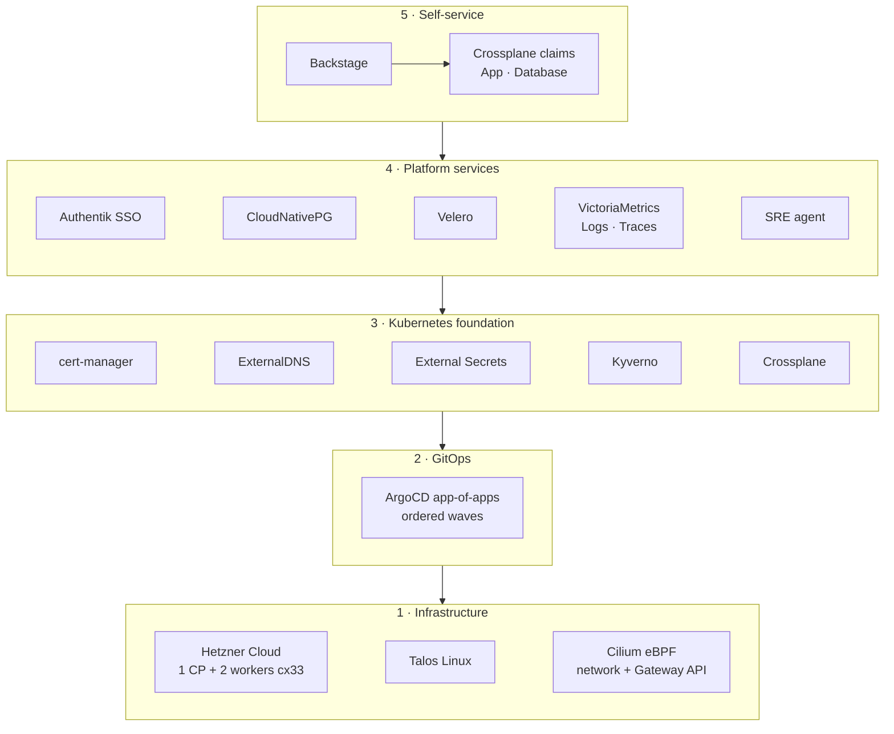
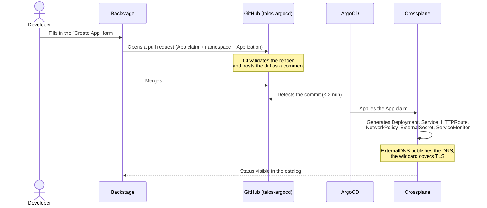

# Architecture

The platform reads as five layers. Each one depends only on the layers below it, and each one is
described in Git.

## 1 · Infrastructure: `talos-infra`

| Item | Choice | Why, in one line |
|---|---|---|
| Hosting provider | Hetzner Cloud, Falkenstein (`fsn1`) | The best price per GB of RAM among the providers tried ([decision 004](decisions/004-retour-hetzner.md)) |
| Machines | 1 control plane + 2 `cx33` workers (4 vCPU / 8 GB) | The control plane is reserved for Kubernetes, the workers carry the applications |
| OS | Talos Linux | Immutable, no SSH or shell, driven by API: less attack surface, nothing to patch by hand |
| Provisioning | Terraform + `hcloud-k8s` module | A maintained module rather than a fork ([decision 001](decisions/001-talos-hetzner-terraform.md)) |
| Terraform state | S3 backend on Backblaze B2 | Outside Hetzner: survives the destruction of the cluster |
| Network | Cilium (eBPF), replaces kube-proxy, serves the Gateway API | One component for networking, policies and HTTP ingress ([decision 008](decisions/008-gateway-api-cilium.md)) |
| Ingress | Hetzner `lb11` load balancer, PROXY protocol v2 | The client's real IP reaches the pods |
| Admin access | Kubernetes and Talos APIs filtered to the administrator's IP | Nothing administrable is exposed publicly |

## 2 · GitOps: `talos-argocd`

A root Application discovers every `application.yaml` file in the repo. Adding a component means
dropping a file: nothing to register elsewhere.

ArgoCD has no notion of dependencies between Applications. Order therefore comes from **waves**: wave N+1
starts only once all of wave N is synced **and** healthy.

| Wave | Content | Why at this rank |
|---|---|---|
| -1 · 0 | ArgoCD projects, ArgoCD itself | ArgoCD manages itself from the start |
| 10 – 12 | Operators: cert-manager, External Secrets, Kyverno, CloudNativePG, Crossplane | They install the types (CRDs) that what follows needs |
| 19 – 22 | Configuration: certificates, DNS, Gateway, network and Kyverno policies, Crossplane API | Can only be applied once the types are known |
| 30 – 31 | Observability and platform services | Need the secrets, DNS and certificates |
| 40 | Business applications | Last, on a complete platform |

→ [Decision 006](decisions/006-app-of-apps-sync-waves.md)

## 3 · Kubernetes foundation

| Need | Tool | How it works |
|---|---|---|
| TLS certificates | cert-manager + Let's Encrypt | One *wildcard* `*.taloslab.cc` certificate via Cloudflare DNS challenge |
| DNS | ExternalDNS | Creates the Cloudflare record as soon as an HTTP route appears, deletes it afterwards |
| Secrets | Infisical (SaaS, EU) → External Secrets Operator | No secret in Git ([decision 009](decisions/009-secrets-infisical-eso.md)) |
| Guardrails | Kyverno (11 CEL policies) | Blocks the deletion of resources that hold data ([decision 010](decisions/010-kyverno-audit-garde-fous.md)) |
| Network | Cluster-wide Cilium *default-deny* policy | Every allowed flow is written explicitly |
| Homemade API | Crossplane v2 + Python compositions | [Decision 007](decisions/007-crossplane-api-self-service.md) |

## 4 · Platform services

| Service | Role |
|---|---|
| **Authentik** | Single identity provider (OIDC) for ArgoCD, Backstage, Grafana, n8n and the saveit application |
| **CloudNativePG** | PostgreSQL databases managed by an operator, write-ahead logs (WAL) archived continuously to B2: restore to the second |
| **Velero** | Daily backup of Kubernetes objects to B2, and of Crossplane resources every 6 h |
| **talos-backup** | Daily etcd snapshot to B2: the only copy of the cluster state outside Hetzner |
| **VictoriaMetrics / Logs / Traces** | Metrics, logs and traces; Grafana for dashboards, Slack alerts |
| **Gatus** | External availability probe for public services |
| **SRE agent** | Automatic investigation of failures ([sre-agent](projets/sre-agent.md)) |

## 5 · Self-service

The path of a developer who wants to deploy an application:

## What protects the data

| Threat | Protection |
|---|---|
| Accidental deletion by Git (*prune*) | Kyverno policy: a Crossplane resource can only be deleted with an explicit annotation |
| Loss of a database | CloudNativePG WAL archived continuously to B2, point-in-time recovery (PITR) |
| Loss of the whole cluster | Rebuild with `task apply`, then Velero and CNPG restore from B2 ([real incident](incidents.md#prune-saveit)) |
| Secret leak | Nothing in Git or in the Terraform state (*write-only* attributes) |
| Let's Encrypt quota (5 certificates / 7 days) | Certificates are backed up before destruction and re-injected on rebuild |
