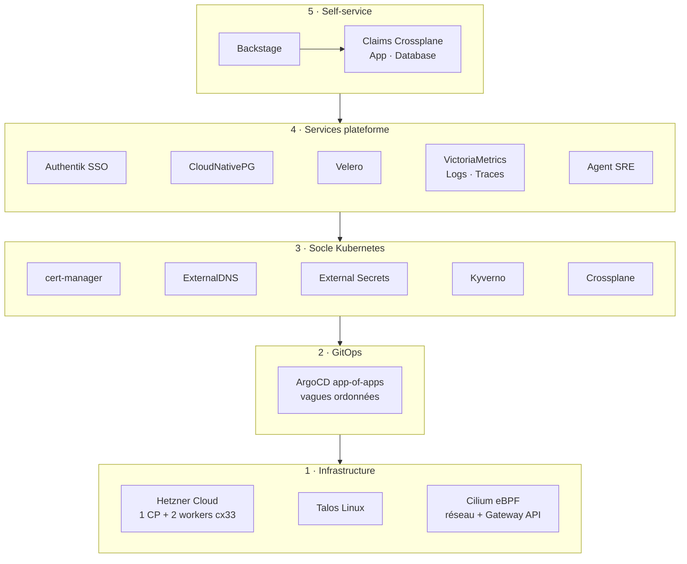
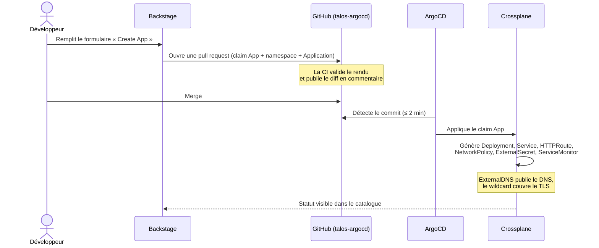

# Architecture

La plateforme se lit en cinq couches. Chacune ne dépend que de celles du dessous, et chacune est
décrite dans Git.

## 1 · Infrastructure : `talos-infra`

| Élément | Choix | Pourquoi en une ligne |
|---|---|---|
| Hébergeur | Hetzner Cloud, Falkenstein (`fsn1`) | Le meilleur prix par Go de RAM parmi les hébergeurs essayés ([décision 004](decisions/004-retour-hetzner.md)) |
| Machines | 1 control plane + 2 workers `cx33` (4 vCPU / 8 Go) | Le control plane est réservé à Kubernetes, les workers portent les applications |
| OS | Talos Linux | Immuable, sans SSH ni shell, piloté par API : moins de surface d'attaque, rien à patcher à la main |
| Provisioning | Terraform + module `hcloud-k8s` | Un module maintenu plutôt qu'un fork ([décision 001](decisions/001-talos-hetzner-terraform.md)) |
| État Terraform | Backend S3 sur Backblaze B2 | Hors de Hetzner : survit à la destruction du cluster |
| Réseau | Cilium (eBPF), remplace kube-proxy, sert la Gateway API | Un composant pour le réseau, les politiques et l'entrée HTTP ([décision 008](decisions/008-gateway-api-cilium.md)) |
| Entrée | Load balancer Hetzner `lb11`, PROXY protocol v2 | L'IP réelle du client arrive jusqu'aux pods |
| Accès admin | API Kubernetes et Talos filtrées sur l'IP de l'administrateur | Rien d'administrable n'est exposé publiquement |

## 2 · GitOps : `talos-argocd`

Une Application racine découvre tout fichier `application.yaml` du dépôt. Ajouter un composant revient à
déposer un fichier : rien à enregistrer ailleurs.

ArgoCD ne connaît pas de dépendances entre Applications. L'ordre vient donc de **vagues** : la vague N+1
ne démarre que lorsque toute la vague N est synchronisée **et** en bonne santé.

| Vague | Contenu | Pourquoi à ce rang |
|---|---|---|
| -1 · 0 | Projets ArgoCD, ArgoCD lui-même | ArgoCD se gère lui-même dès le départ |
| 10 – 12 | Opérateurs : cert-manager, External Secrets, Kyverno, CloudNativePG, Crossplane | Ils installent les types (CRD) dont la suite a besoin |
| 19 – 22 | Configuration : certificats, DNS, Gateway, politiques réseau et Kyverno, API Crossplane | Ne peut s'appliquer qu'une fois les types connus |
| 30 – 31 | Observabilité et services plateforme | Ont besoin des secrets, du DNS et des certificats |
| 40 | Applications métier | En dernier, sur une plateforme complète |

→ [Décision 006](decisions/006-app-of-apps-sync-waves.md)

## 3 · Socle Kubernetes

| Besoin | Outil | Fonctionnement |
|---|---|---|
| Certificats TLS | cert-manager + Let's Encrypt | Un certificat *wildcard* `*.taloslab.cc` par challenge DNS Cloudflare |
| DNS | ExternalDNS | Crée l'enregistrement Cloudflare dès qu'une route HTTP apparaît, le supprime ensuite |
| Secrets | Infisical (SaaS, UE) → External Secrets Operator | Aucun secret dans Git ([décision 009](decisions/009-secrets-infisical-eso.md)) |
| Garde-fous | Kyverno (11 politiques CEL) | Bloque la suppression des ressources qui portent des données ([décision 010](decisions/010-kyverno-audit-garde-fous.md)) |
| Réseau | Politique *default-deny* Cilium à l'échelle du cluster | Chaque flux autorisé est écrit explicitement |
| API maison | Crossplane v2 + compositions en Python | [Décision 007](decisions/007-crossplane-api-self-service.md) |

## 4 · Services plateforme

| Service | Rôle |
|---|---|
| **Authentik** | Fournisseur d'identité unique (OIDC) pour ArgoCD, Backstage, Grafana, n8n et l'application saveit |
| **CloudNativePG** | Bases PostgreSQL gérées par un opérateur, journaux (WAL) archivés en continu sur B2 : restauration à la seconde près |
| **Velero** | Sauvegarde quotidienne des objets Kubernetes vers B2, et des ressources Crossplane toutes les 6 h |
| **talos-backup** | Snapshot etcd quotidien vers B2 : la seule copie de l'état du cluster hors de Hetzner |
| **VictoriaMetrics / Logs / Traces** | Métriques, logs et traces ; Grafana pour les dashboards, alertes Slack |
| **Gatus** | Sonde externe de disponibilité des services publics |
| **Agent SRE** | Enquête automatique sur les pannes ([sre-agent](projets/sre-agent.md)) |

## 5 · Self-service

Le chemin d'un développeur qui veut déployer une application :

## Ce qui protège les données

| Menace | Protection |
|---|---|
| Suppression accidentelle par Git (*prune*) | Politique Kyverno : une ressource Crossplane ne se supprime qu'avec une annotation explicite |
| Perte d'une base | WAL CloudNativePG archivés en continu sur B2, restauration à un instant donné (PITR) |
| Perte du cluster entier | Reconstruction par `task apply`, puis restauration Velero et CNPG depuis B2 ([incident réel](incidents.md#prune-saveit)) |
| Fuite de secret | Rien dans Git ni dans l'état Terraform (attributs *write-only*) |
| Quota Let's Encrypt (5 certificats / 7 jours) | Les certificats sont sauvegardés avant destruction et réinjectés à la reconstruction |
