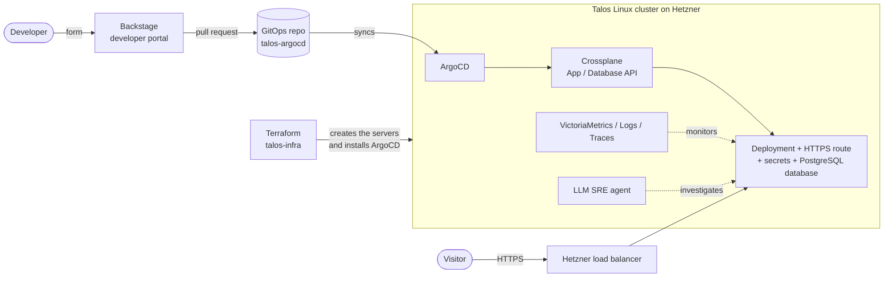

# Taloslab

**A complete Kubernetes platform, built and operated solo, on €41/month Hetzner servers:
from bare servers up to the developer portal, including security, backups, observability
and an LLM-driven SRE agent.**

The goal is not to host an application, but to reproduce at small scale what a platform
team provides to developers: *"fill in a form, your application is online with its
database, DNS, TLS certificate, secrets and dashboards"*.

!!! info "The code is private, the reasoning is public"
    The platform repos are private; only the [showcase](projets/talos-landing.md) is public.
    This site publishes the **why**: the decisions, their costs, what broke. I show the code on request in interviews.

## At a glance

## Key figures

| | |
|---|---|
| Monthly cost | **€41.36** incl. VAT (1 control plane + 2 `cx33` workers, load balancer, IPv4), volumes ~€7.5 extra |
| Platform components | **35 infrastructure ArgoCD Applications**, deployed in ordered waves |
| Full rebuild | One `task apply`: servers, OS, network, GitOps, then automatic convergence |
| Network security | Everything denied by default (Cilium *default-deny*), every flow opened explicitly |
| Secrets in Git | **Zero**: 19 secrets synced from Infisical |
| Observability retention | Metrics and logs 180 days, traces 15 days |
| History | ~950 commits on the GitOps repo, nearly 50 PRDs (design documents) written and closed |

## In two minutes

- **Infrastructure as Code end to end.** Terraform creates the servers and installs Talos Linux, an
  immutable, SSH-less OS built for Kubernetes, then hands over to ArgoCD. → [talos-infra](projets/talos-infra.md)
- **Strict GitOps.** Everything running in the cluster is described in a Git repo; a change
  made by hand is reverted within a minute or two. → [talos-argocd](projets/talos-argocd.md)
- **A home-grown API for developers.** With Crossplane, a 15-line file (`kind: App`) generates
  about ten Kubernetes resources: deployment, HTTPS route, network policy, secrets, monitoring.
  → [Decision 007](decisions/007-crossplane-api-self-service.md)
- **A developer portal.** Backstage turns this API into forms, with SSO authentication
  and an MCP server to drive the portal from an AI assistant. → [talos-backstage](projets/talos-backstage.md)
- **An SRE agent.** A Go controller detects failures and an LLM agent investigates (read-only kubectl,
  metrics, logs), then proposes a fix as a pull request. → [sre-agent](projets/sre-agent.md)

## What this project mostly shows

**Defended decisions, then challenged with evidence.** The platform was rebuilt across
three hosting providers and two GitOps tools without rewriting the applications. Every switch rests on a
measurement, and every rollback on an A/B proof. This is the most useful part to read:

- [ArgoCD → Flux → ArgoCD: testing a better architecture, coming back to the market standard](decisions/005-argocd-flux-argocd.md)
- [Hetzner → Infomaniak → Scaleway → Hetzner](decisions/004-retour-hetzner.md)
- [A migration incident contained by a guardrail and restored with no data loss](incidents.md#prune-saveit)

## Reading paths

=== "2 minutes"

    This page, then the [decisions table](decisions/index.md).

=== "10 minutes"

    [Architecture](architecture.md) → [Decisions](decisions/index.md) →
    [Lessons learned](incidents.md) → [Next steps](limites.md).

=== "Preparing a technical interview"

    [Interview questions](faq.md): the likely "why X rather than Y", with short
    answers.
