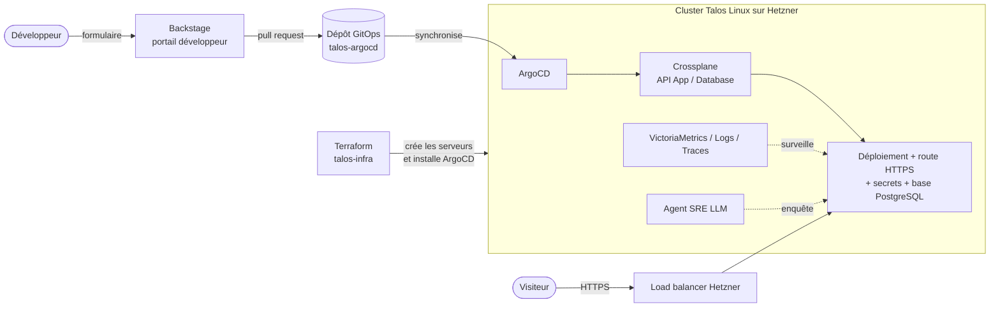

# Taloslab

**Une plateforme Kubernetes complète, construite et opérée seul, sur des serveurs Hetzner à 41 €/mois :
du serveur nu jusqu'au portail développeur, en passant par la sécurité, les sauvegardes, l'observabilité
et un agent SRE piloté par LLM.**

Le but n'est pas d'héberger une application, mais de reproduire à petite échelle ce qu'une équipe
plateforme fournit à des développeurs : *« remplis un formulaire, ton application est en ligne avec sa
base de données, son DNS, son certificat TLS, ses secrets et ses dashboards »*.

!!! info "Le code est privé, le raisonnement est public"
    Les dépôts de la plateforme sont privés, seule la [vitrine](projets/talos-landing.md) est publique.
    Ce site publie le **pourquoi** : les décisions, leurs coûts, ce qui a cassé. Je montre le code sur demande en entretien.

## En un schéma

## Chiffres clés

| | |
|---|---|
| Coût mensuel | **41,36 €** TTC (1 control plane + 2 workers `cx33`, load balancer, IPv4), volumes ~7,5 € en plus |
| Composants plateforme | **35 Applications ArgoCD** d'infrastructure, déployées par vagues ordonnées |
| Reconstruction complète | Un `task apply` : serveurs, OS, réseau, GitOps, puis convergence automatique |
| Sécurité réseau | Tout est refusé par défaut (*default-deny* Cilium), chaque flux est ouvert explicitement |
| Secrets dans Git | **Zéro** : 19 secrets synchronisés depuis Infisical |
| Rétention observabilité | Métriques et logs 180 jours, traces 15 jours |
| Historique | ~950 commits sur le dépôt GitOps, près de 50 PRD (documents de conception) rédigés et clôturés |

## En deux minutes

- **Infrastructure as Code de bout en bout.** Terraform crée les serveurs et installe Talos Linux, un OS
  immuable sans SSH conçu pour Kubernetes, puis passe la main à ArgoCD. → [talos-infra](projets/talos-infra.md)
- **GitOps strict.** Tout ce qui tourne dans le cluster est décrit dans un dépôt Git ; une modification
  faite à la main est annulée en une à deux minutes. → [talos-argocd](projets/talos-argocd.md)
- **Une API maison pour les développeurs.** Avec Crossplane, un fichier de 15 lignes (`kind: App`) génère
  une dizaine de ressources Kubernetes : déploiement, route HTTPS, politique réseau, secrets, monitoring.
  → [Décision 007](decisions/007-crossplane-api-self-service.md)
- **Un portail développeur.** Backstage transforme cette API en formulaires, avec authentification SSO
  et un serveur MCP pour piloter le portail depuis un assistant IA. → [talos-backstage](projets/talos-backstage.md)
- **Un agent SRE.** Un contrôleur Go détecte les pannes et un agent LLM enquête (kubectl en lecture
  seule, métriques, logs), puis propose un correctif sous forme de pull request. → [sre-agent](projets/sre-agent.md)

## Ce que ce projet montre surtout

Des **décisions défendues, puis remises en cause sur mesure**. Le projet a changé deux fois d'outil
GitOps et trois fois d'hébergeur. Chaque changement s'appuie sur une mesure, et un des retours en
arrière a montré que la panne d'origine avait été mal attribuée. C'est la partie la plus utile à lire :

- [ArgoCD → Flux → ArgoCD : un bug mal attribué](decisions/005-argocd-flux-argocd.md)
- [Hetzner → Infomaniak → Scaleway → Hetzner](decisions/004-retour-hetzner.md)
- [L'incident où une migration a détruit une base de données, restaurée sans perte](incidents.md#prune-saveit)

## Parcours de lecture

=== "2 minutes"

    Cette page, puis le [tableau des décisions](decisions/index.md).

=== "10 minutes"

    [Architecture](architecture.md) → [Décisions](decisions/index.md) →
    [Ce qui a cassé](incidents.md) → [Limites connues](limites.md).

=== "Préparer un entretien technique"

    [Questions d'entretien](faq.md) : les « pourquoi X plutôt que Y » probables, avec des réponses
    courtes.
