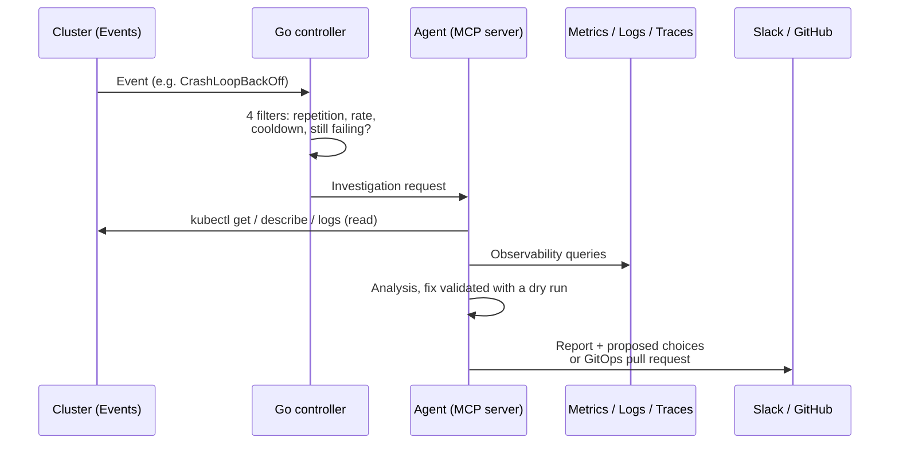

# sre-agent: the LLM-driven SRE agent

> **A Kubernetes controller detects a failure, an LLM agent investigates with read-only tools,
> then proposes a fix, by pull request when the resource is managed through GitOps.**

| | |
|---|---|
| Role | Automatic failure diagnosis, remediation under human control |
| Tools | TypeScript (MCP server, Vercel AI SDK), Go (kubebuilder controller), Helm, VictoriaMetrics MCP |
| Visibility | Private |

## How it works

## Notable choices

| Choice | Reason |
|---|---|
| **Manual mode in production**: the agent notifies and proposes, a human decides | An LLM makes mistakes; trust is built before automation |
| **GitOps-managed resource → pull request**, never `kubectl` | A direct fix would be reverted by ArgoCD and create drift |
| **Four filters on the controller side** before calling the LLM | A flapping failure must not trigger an investigation on every event |
| **Fix validated server-side with a dry run** (`--dry-run=server`) before being proposed | Only propose what the Kubernetes API would accept |
| **The official VictoriaMetrics MCP servers** rather than rewriting tools | Less code; the agent is an MCP client of observability |
| **Several LLM providers** behind a single model table | Being able to change model without touching the code |
| **Shared token rather than OAuth** | A single user, service internal to the cluster |

## Where it comes from

The project carries a slice of an existing open source project (*dot-ai*). A first attempt had
diverged too far from upstream and was abandoned. Lesson: re-read the upstream code at every decision.
About 170 tests (Vitest on the TypeScript side, Ginkgo / envtest on the Go side).

## Limits

See [Known limits](../limites.md#chantiers-ouverts): the agent's least privilege is the
next work item, before any automatic mode.
