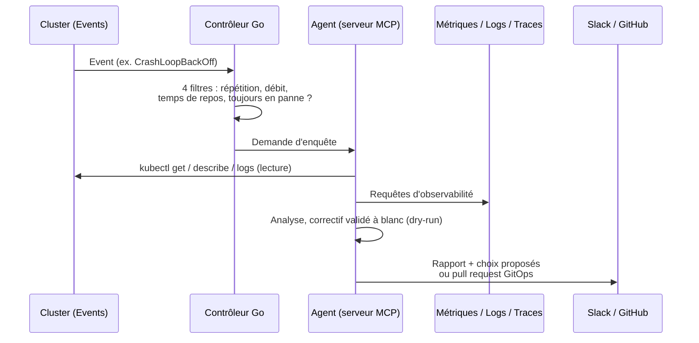

# sre-agent : l'agent SRE piloté par LLM

> **Un contrôleur Kubernetes détecte une panne, un agent LLM enquête avec des outils en lecture seule,
> puis propose un correctif, par pull request quand la ressource est gérée en GitOps.**

| | |
|---|---|
| Rôle | Diagnostic automatique des pannes, remédiation sous contrôle humain |
| État | **En cours de développement**, déployé en mode manuel |
| Outils | TypeScript (serveur MCP, Vercel AI SDK), Go (contrôleur kubebuilder), Helm, VictoriaMetrics MCP |
| Visibilité | Privé |

## Comment ça marche

## Choix notables

| Choix | Raison |
|---|---|
| **Mode manuel en production** : l'agent notifie et propose, un humain décide | Un LLM se trompe ; la confiance se construit avant l'automatisation |
| **Ressource gérée en GitOps → pull request**, jamais `kubectl` | Une correction directe serait annulée par ArgoCD et créerait de la dérive |
| **Quatre filtres côté contrôleur** avant d'appeler le LLM | Une panne qui clignote ne doit pas déclencher une enquête à chaque événement |
| **Correctif validé côté serveur à blanc** (`--dry-run=server`) avant d'être proposé | Ne proposer que ce que l'API Kubernetes accepterait |
| **Les serveurs MCP officiels de VictoriaMetrics** plutôt que réécrire des outils | Moins de code ; l'agent est client MCP de l'observabilité |
| **Plusieurs fournisseurs LLM** derrière une seule table de modèles | Pouvoir changer de modèle sans toucher au code |
| **Jeton partagé plutôt qu'OAuth** | Un seul utilisateur, service interne au cluster |

## D'où il vient

Le projet porte une tranche d'un projet open source existant (*dot-ai*). Une première tentative avait
trop divergé de l'amont et a été abandonnée. Leçon : relire le code amont à chaque décision.
Environ 170 tests (Vitest côté TypeScript, Ginkgo / envtest côté Go).

## Prochaines étapes

Durcissement du moindre privilège outil par outil et budget global de consommation LLM, avant tout
mode automatique. Voir la [feuille de route](../limites.md#chantiers-ouverts).
