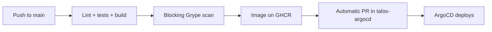

# talos-landing: the showcase

> **A public page that displays the real state of the cluster (nodes, load, components, services), read
> directly from the Kubernetes API every 30 seconds.**

| | |
|---|---|
| Role | Cluster showcase, public entry point |
| Tools | Flask, HTMX, AlpineJS, Tailwind CSS, Python Kubernetes client |
| Visibility | **Public**: [github.com/naqa92-portfolio-projects/talos-landing](https://github.com/naqa92-portfolio-projects/talos-landing) |

## Notable choices

| Choice | Reason |
|---|---|
| Server-side rendering + HTMX refresh | No JavaScript framework for a status page |
| Visible services are declared by annotation on their route | Exposing a service on the showcase requires no change to the showcase |
| **Explicit** demo mode (`TALOS_MOCK=1`) | An implicit demo mode would pass a broken service account off as a healthy cluster |
| Controlled degradation | If the API or a CRD is missing, the page still renders with the "unknown" state |
| Non-root image, blocking vulnerability scan | The pipeline builds, scans, publishes, then opens the update PR in the GitOps repo |

## The path of a new version

