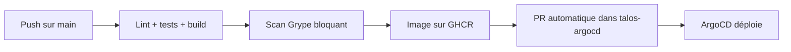

# talos-landing : la vitrine

> **Une page publique qui affiche l'état réel du cluster (nœuds, charge, composants, services), lu
> directement sur l'API Kubernetes toutes les 30 secondes.**

| | |
|---|---|
| Rôle | Vitrine du cluster, point d'entrée public |
| Outils | Flask, HTMX, AlpineJS, Tailwind CSS, client Kubernetes Python |
| Visibilité | **Public** : [github.com/naqa92-portfolio-projects/talos-landing](https://github.com/naqa92-portfolio-projects/talos-landing) |

## Choix notables

| Choix | Raison |
|---|---|
| Rendu serveur + rafraîchissement HTMX | Pas de framework JavaScript pour une page de statut |
| Les services visibles sont déclarés par annotation sur leur route | Exposer un service sur la vitrine ne demande aucune modification de la vitrine |
| Mode démo **explicite** (`TALOS_MOCK=1`) | Un mode démo implicite ferait passer un compte de service cassé pour un cluster sain |
| Dégradation contrôlée | Si l'API ou une CRD manque, la page s'affiche quand même avec l'état « inconnu » |
| Image non root, scan de vulnérabilités bloquant | Le pipeline construit, scanne, publie, puis ouvre la PR de mise à jour dans le dépôt GitOps |

## Le chemin d'une nouvelle version

